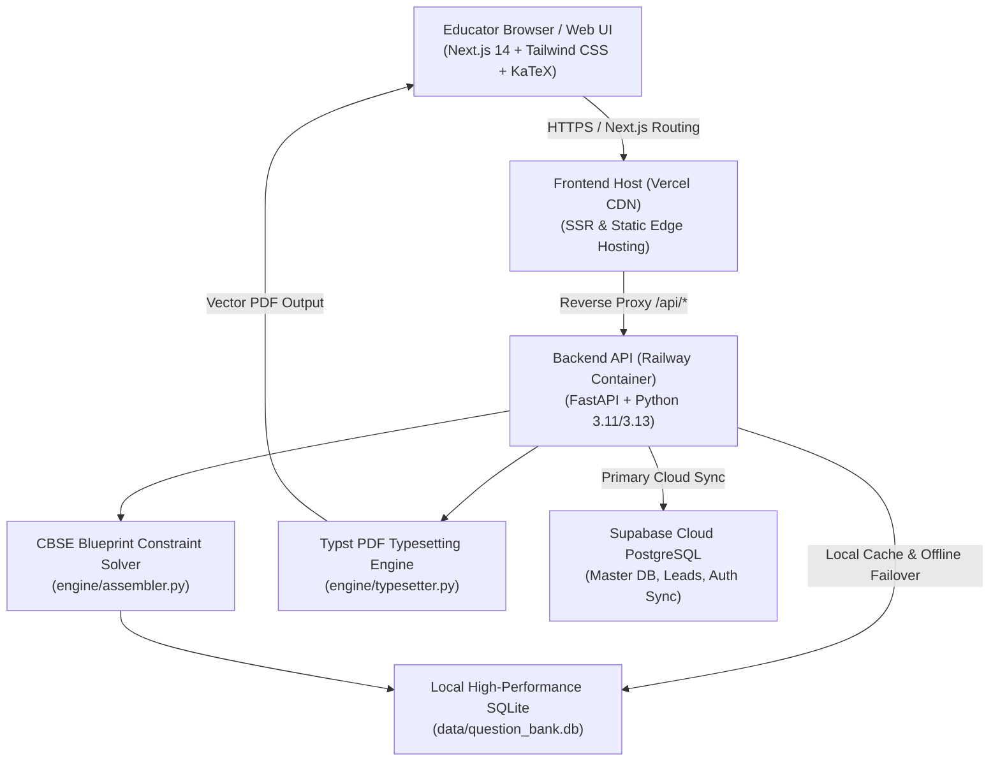

# Autonomous CBSE AI Question Paper Generator
## Complete System Architecture, Features, & Technical Handover Manual

> **Document Version:** 1.0.0  
> **Last Updated:** October 2026  
> **Repository:** `https://github.com/Shubh852/ai-question-paper-generator.git`  
> **Production Frontend (Vercel):** `https://ai-question-paper-generator-ohrm.vercel.app`  
> **Production Backend (Railway):** `https://web-production-e42c0.up.railway.app`  
> **Cloud Database (Supabase PostgreSQL):** `https://kwlrfcogywkmrhyzusqg.supabase.co`

---

## 1. Executive Summary & Project Purpose

The **Autonomous AI Question Paper Generator** is a production-grade, full-stack educational technology platform engineered specifically for Indian CBSE Board educators (Classes 10, 11, and 12) as well as competitive examination formats (IIT-JEE Main/Advanced, NEET). 

The platform allows teachers to assemble, balance, customize, brand, and download **board-compliant, print-ready question papers** alongside **step-wise model answers and marking rubrics** in seconds.

### Core Value Propositions
1. **Official CBSE Blueprint Conformance:** Strict 5-section architecture (Sections A through E: MCQs, VSA, SA, LA, and Case Study units) adhering precisely to official NCERT & CBSE marking schemes.
2. **Deterministic & Ground-Truth Answers:** Absolutely zero synthetic or hallucinated solutions. All 2,761 questions come directly from a curated question bank with verified mathematical proofs, step-by-step rubrics, and official answer keys.
3. **High-Speed Vector Typesetting via Typst:** Generates publication-quality vector PDFs in < 500ms, featuring school logo emblems, customized headers, KaTeX-formatted mathematics, circuit diagrams, ray optics figures, and clean grading tables.
4. **Multi-Format Output Options:** Instant single-click downloads for:
   - **Student Question Paper:** Clean examination paper without answers.
   - **Teacher Solution Copy:** Complete answer key with step-wise mark allocations.
   - **📦 Combined Exam Kit:** Unified single PDF containing both the question paper and the solution key separated by a clean page break.
5. **Educator Authentication & PLG Lead Retention:** Secure authentication engine with SHA-256 password verification, credential remembering for returning teachers, and continuous synchronization to Supabase for lead tracking and paper creation analytics.

---

## 2. System Architecture & Tech Stack



### Technology Breakdown

| Tier | Component | Technology / Library | Purpose |
| :--- | :--- | :--- | :--- |
| **Frontend** | Framework | Next.js 14 (App Router) | High-performance React SSR/SSG application |
| | Styling | Tailwind CSS | Modern, responsive educational UI |
| | Icons | Lucide React | Clean, consistent icons across wizard & modal |
| | Math Preview | KaTeX (`LatexRenderer.tsx`) | Real-time mathematical formula rendering |
| **Backend** | Framework | FastAPI (Python) | High-throughput asynchronous REST API |
| | Web Server | Uvicorn | ASGI production server |
| | Data Validation | Pydantic v2 | Request/response schema validation |
| **Typesetting**| Engine | Typst (`engine/typesetter.py`) | Rust-based modern typesetter for instant vector PDFs |
| **Database** | Cloud Engine | Supabase PostgreSQL | Central database with Row Level Security (RLS) |
| | Local Engine | SQLite (`data/question_bank.db`)| Zero-latency local storage and failover engine |
| **Deployment**| Frontend | Vercel | Production web hosting with auto-deploy on `git push` |
| | Backend | Railway (Nixpacks/Procfile) | Containerized backend service with Typst CLI installed |

---

## 3. Database Architecture & Question Bank Metrics

The database architecture features a **dual-storage design**: it writes to both the cloud Supabase PostgreSQL instance and a local high-performance SQLite engine (`data/question_bank.db`) to ensure 100% uptime, zero latency, and resilience against network drops.

### Database Schema

#### 1. `master_question_bank`
Stores all curated, board-standard questions with complete mathematical solutions and grading rubrics.
- `id` (UUID / TEXT PRIMARY KEY)
- `grade_level` (INTEGER: 10, 11, or 12)
- `subject` (VARCHAR: Mathematics, Science, Physics, Chemistry, Biology, English, Social Science)
- `chapter` (VARCHAR: Chapter title, e.g., "Quadratic Equations", "Optics")
- `topic` (VARCHAR: Specific sub-topic)
- `primary_exam` (VARCHAR: CBSE_BOARD, JEE_MAIN, JEE_ADVANCED, NEET)
- `applicable_exams` (JSON Array of applicable target exams)
- `difficulty_tier` (INTEGER: 1=Basic Board, 2=Moderate, 3=Standard Board, 4=HOTS, 5=Competitive)
- `question_format` (VARCHAR: MCQ, ASSERTION_REASON, SHORT_ANSWER, LONG_ANSWER, CASE_STUDY)
- `marks` (REAL: 1.0, 2.0, 3.0, 4.0, 5.0)
- `question_text_latex` (TEXT: Full statement with LaTeX formulas and optional diagram links)
- `options` (JSON Object: `{"A": "...", "B": "...", "C": "...", "D": "..."}` for MCQs)
- `correct_option` (VARCHAR: "A", "B", "C", or "D")
- `ideal_solution_latex` (TEXT: Step-by-step mathematical proof / model answer)
- `step_marking_rubric` (JSON Array: `[{"step": 1, "rule": "Formula identification", "allocated_marks": 1.0}]`)
- `source_book` (VARCHAR: NCERT, Exemplar, CBSE Board Paper)
- `content_hash` (VARCHAR: Unique SHA-256 fingerprint to prevent duplicates)
- `created_at` (TIMESTAMP)

#### 2. `generated_exams`
Stores generated blueprints and question selections for persistence and saved history.
- `id` (UUID PRIMARY KEY)
- `title` (VARCHAR: Exam title)
- `grade_level` (INTEGER)
- `subject` (VARCHAR)
- `total_marks` (INTEGER: e.g., 80, 70, 40)
- `duration_minutes` (INTEGER: e.g., 180, 120, 60)
- `exam_type` (VARCHAR: CBSE_BOARD, JEE_MAIN, NEET, HYBRID)
- `selected_chapters` (JSON Array)
- `blueprint_breakdown` (JSON Object)
- `question_ids` (JSON Array)
- `student_pdf_url` (VARCHAR)
- `solution_pdf_url` (VARCHAR)
- `created_at` (TIMESTAMP)

#### 3. `teacher_leads` & `teacher_accounts`
Maintains educator registration details, school branding, and passwords.
- `id` (UUID PRIMARY KEY)
- `teacher_name` / `name` (VARCHAR)
- `school_name` / `school` (VARCHAR: encodes `{school}||{email}||{pwd_hash}` for cloud persistence)
- `city` (VARCHAR)
- `whatsapp_number` / `whatsapp` (VARCHAR)
- `email` (VARCHAR)
- `password_hash` (VARCHAR: SHA-256 cryptographic digest)
- `generated_exam_id` (UUID FOREIGN KEY to `generated_exams.id`)
- `created_at` (TIMESTAMP)

### Question Bank Subject & Grade Breakdown
The question bank contains **2,761 verified questions**:

| Grade Level | Subject | Questions in Bank | Primary Question Formats |
| :--- | :--- | :--- | :--- |
| **Class 10** | Science | **749** | MCQs, Assertion-Reason, VSA, SA, LA, Case Study |
| **Class 10** | Mathematics | **124** | MCQs, VSA, SA, LA, Case Study |
| **Class 10** | Social Science | **25** | Objective, SA, LA |
| **Class 10** | English | **7** | Reading & Literature Units |
| **Class 11** | Mathematics | **197** | MCQs, VSA, SA, LA |
| **Class 11** | Chemistry | **25** | MCQs, Reactions, Short Answer |
| **Class 11** | Physics | **23** | Derivations, Numerical Problems |
| **Class 11** | Biology | **17** | MCQs, Descriptive Diagrams |
| **Class 12** | Mathematics | **1,149** | Complete Calculus, Vectors, Probability, Algebra |
| **Class 12** | Physics | **385** | Optics, Electrostatics, Magnetism, Modern Physics |
| **Class 12** | Chemistry | **31** | Organic, Inorganic, Physical Chemistry |
| **Class 12** | Biology | **22** | Genetics, Ecology, Reproduction |
| **Class 12** | English | **7** | Literature, Writing Skills |
| **Total** | | **2,761** | Verified questions with complete solutions & rubrics |

---

## 4. CBSE Blueprint Engine (`engine/assembler.py`)

The exam assembly algorithm is an intelligent constraint satisfaction solver that constructs exams based on official CBSE Board guidelines.

### Section Breakdown (Standard 80-Mark CBSE Format)
1. **Section A (1 Mark each):** 16 Multiple Choice Questions + 2 Assertion-Reason questions (18 Marks total).
2. **Section B (2 Marks each):** 5 Very Short Answer (VSA) questions with internal choices (10 Marks total).
3. **Section C (3 Marks each):** 6 Short Answer (SA) questions with internal choices (18 Marks total).
4. **Section D (5 Marks each):** 4 Long Answer (LA) questions with internal choices (20 Marks total).
5. **Section E (4 Marks each):** 3 Case-Based / Integrated Data Questions with sub-parts (12 Marks total).

### Assembly Algorithm Logic
- **Chapter Weightage Balancing:** Evenly distributes marks across selected chapters based on teacher-specified syllabus scope.
- **Difficulty Distribution Weights:** Applies customizable weight sliders:
  - *Easy / Foundational (Tier 1 & 2):* ~30%
  - *Moderate / Standard Board (Tier 3):* ~50%
  - *HOTS / Challenging (Tier 4 & 5):* ~20%
- **Single-Question Dynamic Swap:** If a teacher dislikes a specific question in the interactive preview, they click **"Swap Question"**. The backend queries the question bank for an equivalent replacement:
  - Matches the exact mark allocation ($1\text{M}, 2\text{M}, 3\text{M}, 4\text{M}, 5\text{M}$).
  - Matches the section and question format (MCQ, VSA, LA, etc.).
  - Excludes all currently assembled question IDs to guarantee zero duplication.

---

## 5. Mathematical Typesetting Engine (`engine/typesetter.py`)

The PDF generation pipeline compiles directly to vector PDF using Typst, offering instant rendering, perfect alignment, and crisp mathematical typography.

### Delimiter Sanitization & Token Protection
Typst treats unescaped characters like `*`, `_`, `#`, `@`, `<`, and `>` as formatting tags. To prevent syntax crashes (e.g., `unclosed delimiter` errors) when formulas contain multiplication or variable underscores:
1. **Math Block Extraction:** Display math (`$$...$$`) and inline math (`$...$`) are extracted and converted into Typst native math syntax (`$ ... $`).
2. **Alphanumeric Tokenization:** Extracted formulas are replaced by pure alphanumeric sentinels: `TYPSTMATHPH{idx}END`. (Underscore-free sentinels guarantee they are never corrupted during markdown escaping).
3. **Prose Escaping:** All prose text outside math blocks is sanitized (`\*`, `\_`, `\#`, `\@`, `\<`, `\>`).
4. **Math Restoration:** Sentinels are replaced with the converted math blocks.

### LaTeX to Typst Math Converter (`latex_to_typst_math`)
Converts standard LaTeX notations to Typst native math expressions:
- Fractions: `\frac{a}{b}` $\rightarrow$ `(a) / (b)`
- Square Roots: `\sqrt{b^2 - 4ac}` $\rightarrow$ `sqrt(b^2 - 4 a c)`
- Plus-Minus: `\pm` $\rightarrow$ `+-`
- Multiplication: `\times` $\rightarrow$ `times`, `\cdot` $\rightarrow$ `dot`
- Relations: `\leq` $\rightarrow$ `<=`, `\geq` $\rightarrow$ `>=`, `\neq` $\rightarrow$ `!=`, `\implies` $\rightarrow$ `==>`
- Greek Letters: `\alpha`, `\beta`, `\gamma`, `\theta`, `\pi`, `\lambda`, `\sigma`, `\Delta`, `\Omega` $\rightarrow$ `alpha`, `beta`, `gamma`, etc.
- Trigonometric & Calculus: `\sin`, `\cos`, `\tan`, `\int`, `\partial`, `\sum` $\rightarrow$ Typst native operators.

### Three Downloadable Document Formats
1. **Student Question Paper:** Includes school logo, school name, exam header, standard CBSE general instructions, section headings, and mark tags.
2. **Solutions & Marking Scheme:** Official answer key, correct MCQ options highlighted in green, step-by-step model answers, and structured evaluation rubric tables.
3. **📦 Combined Exam Kit:** A unified document containing the student question paper, followed by a `#pagebreak()`, followed by the confidential marking scheme.

---

## 6. Frontend Architecture & User Interface

The frontend is built with Next.js 14 and structured around four key components:

### 1. 4-Step Interactive Creation Wizard (`Wizard.tsx`)
- **Step 1: Exam Foundation:** Select Grade (10, 11, 12), Subject, Exam Type (CBSE Pre-Board, Mid-Term, Unit Test, JEE/NEET Foundation), Total Marks, and Duration.
- **Step 2: Chapter Selection & Weightage:** Interactive taxonomy checklist with chapter-wise question counts, topic previews, and difficulty slider controls.
- **Step 3: Interactive Exam Paper Preview:** 
  - Live KaTeX rendering of formulas, diagrams, and section headers.
  - Per-question action toolbar with **"Swap Question"** to replace questions on the fly.
  - Live mark distribution and cognitive balance indicators.
- **Step 4: School Customization & Export:**
  - Input School Name and upload custom School Crest / Emblem.
  - One-click action buttons:
    - `📥 Question Paper (PDF)`
    - `📋 Solution Key (PDF)`
    - `📦 Paper + Solutions (PDF)`

### 2. Educator Authentication Modal (`TeacherAuthModal.tsx`)
- **Sign In vs Sign Up Tabs:** 
  - Automatically remembers returning educators (`localStorage.getItem('cbse_has_registered')`) and defaults directly to **Teacher Sign In (Log In)**.
  - Pre-fills the teacher's registered WhatsApp/Email identifier.
  - Single-click toggle between **Sign In** and **Sign Up**.
- **Cryptographic Security:** Enforces password entry for both login and signup. Passwords are validated and hashed (SHA-256). Invalid credentials display an alert and reject access with HTTP 401/404.
- **1-Click Educator Demo:** Pre-configured demo account ("Dr. Ananya Sharma", Delhi Public School, R.K. Puram) for instant evaluation without typing.

### 3. Saved Papers Dashboard (`SavedPapersDashboard.tsx`)
- Displays all question papers previously generated by the logged-in educator.
- Provides search, preview, and delete functionality.
- Direct download buttons for each saved paper:
  - `Student Copy`
  - `Solutions`
  - `📦 Combined (Paper + Solutions)`

### 4. Mathematical Formula Renderer (`LatexRenderer.tsx`)
- Parses inline (`$...$`) and display (`$$...$$`) LaTeX math formulas and renders them on the client using KaTeX for crisp rendering in the web preview.

---

## 7. REST API Endpoints Specification

All endpoints are hosted on the Railway production backend at `https://web-production-e42c0.up.railway.app`:

| Method | Endpoint | Description | Request Body / Parameters |
| :--- | :--- | :--- | :--- |
| `GET` | `/api/v1/health` | Health check endpoint | Returns `{"status": "healthy"}` |
| `GET` | `/api/v1/taxonomy` | Returns available grades, subjects, chapters, and question counts | None |
| `POST` | `/api/v1/assemble-paper` | Assembles a balanced CBSE question paper | `{grade, subject, chapters, total_marks, duration_minutes, exam_type, difficulty, school_name, school_logo, created_by}` |
| `POST` | `/api/v1/swap-question` | Replaces a single question with an equivalent unused question | `{current_question_id, excluded_ids}` |
| `POST` | `/api/v1/export-pdf` | Compiles and returns binary PDF directly | `{exam: {...}, target: "student" \| "solution" \| "combined"}` |
| `GET` | `/api/v1/download-pdf/{paper_id}` | Downloads compiled PDF by saved exam ID | Query param: `?doc=student`, `?doc=solution`, or `?doc=combined` |
| `GET` | `/api/v1/saved-exams` | Retrieves list of saved exams | Query params: `limit`, `offset` |
| `GET` | `/api/v1/saved-exams/{id}` | Retrieves full exam structure with hydrated questions | Path param: `id` |
| `DELETE`| `/api/v1/saved-exams/{id}` | Deletes exam from history | Path param: `id` |
| `POST` | `/api/v1/auth/signup` | Registers new educator account with password hash | `{name, school, city, email, whatsapp, password, primary_grade, primary_subject}` |
| `POST` | `/api/v1/auth/login` | Authenticates educator with password check | `{email_or_phone, password}` |
| `GET` | `/api/v1/auth/demo` | Returns instant guest credentials for evaluation | None |
| `GET` | `/api/v1/teacher/stats` | Returns educator profile and created paper counts | Query param: `?identifier=...` |

---

## 8. Chronological Development History & Solved Challenges

Here is a summary of major milestones, bug fixes, and engineering decisions throughout the project:

### Milestone 1: Automated Curriculum Ingestion
- **Challenge:** CBSE syllabus spans hundreds of chapters across Classes 10, 11, and 12. Manual question entry was not feasible.
- **Solution:** Developed automated NCERT scrapers and curriculum expansion scripts (`scripts/seed_massive_curriculum.py`, `scripts/import_bulk_repository.py`) seeding 2,761 board questions, complete with diagrams, options, step rubrics, and content hashes.

### Milestone 2: Cloud Sync & Standalone Resilience
- **Challenge:** Containerized backend environments (e.g., Railway) have ephemeral file storage, meaning local SQLite database changes could be lost on redeploy.
- **Solution:** Built a dual-database synchronization architecture in [`backend/database.py`](file:///c:/Users/riddh/OneDrive/Desktop/Question%20paper/backend/database.py). Exam blueprints, teacher accounts, and leads are saved directly to Supabase cloud PostgreSQL, while the local SQLite engine provides zero-latency offline caching.

### Milestone 3: Educator Auth & Registration Flow
- **User Feedback:** Returning teachers were always presented with the "Create Account" tab upon logging out, and wrong credentials were still granting access.
- **Solution:**
  - Configured `localStorage` persistence (`cbse_has_registered`, `cbse_last_identifier`) in [`frontend/components/TeacherAuthModal.tsx`](file:///c:/Users/riddh/OneDrive/Desktop/Question%20paper/frontend/components/TeacherAuthModal.tsx). Returning users default to the **Sign In** tab with their identifier pre-filled.
  - Removed the auto-provisioning fallback in [`backend/main.py`](file:///c:/Users/riddh/OneDrive/Desktop/Question%20paper/backend/main.py) that granted access on failed login.
  - Implemented cryptographic SHA-256 password checking in [`backend/database.py`](file:///c:/Users/riddh/OneDrive/Desktop/Question%20paper/backend/database.py). Non-existent users are rejected with HTTP 404, and wrong passwords are rejected with HTTP 401.

### Milestone 4: Typst Delimiter Syntax Error (500 Error on Solutions)
- **Challenge:** Downloading "Solutions" on saved papers was failing with HTTP 500 (`unclosed delimiter` error in Typst).
- **Solution:** In model answers and rubrics, unescaped prose characters like `*` (e.g. $HCF \times LCM = a \times b$) were treated by Typst as bold tags. Implemented a robust tokenizer in [`engine/typesetter.py`](file:///c:/Users/riddh/OneDrive/Desktop/Question%20paper/engine/typesetter.py) that protects display and inline math while escaping prose characters.

### Milestone 5: Math Placeholder Leakage (`TYPST_MATH_TOKEN`)
- **Challenge:** Question statements and answers in generated PDFs showed text like `__TYPST_MATH_TOKEN_0__` instead of actual equations.
- **Solution:** Because the temporary placeholder token contained underscores (`__TYPST_MATH_TOKEN__`), the prose sanitizer was escaping them into `\_\_TYPST\_MATH\_TOKEN\_\_`, preventing the restoration step from finding the placeholder. Replaced it with pure alphanumeric tokens (`TYPSTMATHPH{idx}END`). Verified on all 2,761 questions with 100% clean compilation.

### Milestone 6: Combined Paper + Solutions Download
- **User Request:** Teachers requested the option to download the question paper and answer key together in a single PDF.
- **Solution:** Added `target="combined"` / `doc="combined"` across backend endpoints, implemented `generate_combined_typst` with a clean `#pagebreak()`, and added **"📦 Paper + Solutions (PDF)"** buttons in both the generation wizard (Step 4) and the saved papers dashboard.

---

## 9. Local Development & Deployment Guide

### Prerequisites
- **Node.js:** v18.x or v20.x
- **Python:** 3.11 or 3.13
- **Typst CLI:** `typst` binary installed (or available via Python `pip install typst`)
- **Git**

### 1. Backend Setup
```bash
# Clone the repository
git clone https://github.com/Shubh852/ai-question-paper-generator.git
cd ai-question-paper-generator

# Create and activate virtual environment
python -m venv .venv
source .venv/bin/activate  # On Windows: .venv\Scripts\activate

# Install dependencies
pip install -r requirements.txt

# Start backend server
uvicorn backend.main:app --host 0.0.0.0 --port 8000 --reload
```

### 2. Frontend Setup
```bash
cd frontend

# Install node dependencies
npm install

# Start development server
npm run dev
# The frontend is available at http://localhost:3000
```

### 3. Environment Variables (`.env`)
```env
# Supabase PostgreSQL Configuration
SUPABASE_URL=https://kwlrfcogywkmrhyzusqg.supabase.co
SUPABASE_SERVICE_ROLE_KEY=sb_publishable_74OMgqGqC1xxAN-rGY5_qg_EhyDwtEJ
SUPABASE_ANON_KEY=sb_publishable_74OMgqGqC1xxAN-rGY5_qg_EhyDwtEJ

# Server Configuration
PORT=8000
HOST=0.0.0.0
ENVIRONMENT=production
```

### 4. Git Deployment Workflow
Both Railway and Vercel are connected to GitHub `main`:
```bash
git add .
git commit -m "feat/fix: description of changes"
git push origin main
```
- **Vercel** automatically detects changes in `/frontend` and deploys the frontend.
- **Railway** automatically builds and restarts the Python FastAPI container with Typst support.

---

## 10. Summary Cheat Sheet for Future AI Sessions

When loading this project into a new AI session (such as Claude, ChatGPT, or another Antigravity session), copy and paste this quick reference:

```text
PROJECT: CBSE AI Question Paper Generator
REPOSITORY: https://github.com/Shubh852/ai-question-paper-generator.git
LIVE APP: https://ai-question-paper-generator-ohrm.vercel.app (Frontend on Vercel)
BACKEND: https://web-production-e42c0.up.railway.app (FastAPI on Railway)
DATABASE: Supabase PostgreSQL (cloud) + SQLite data/question_bank.db (local)

KEY FILES & RESPONSIBILITIES:
- engine/assembler.py: CBSE blueprint solver, 5-section allocation (A-E), chapter weightage, difficulty balancing, question swap algorithm.
- engine/typesetter.py: Typst PDF generator, sanitize_typst_text (uses TYPSTMATHPH...END tokens), latex_to_typst_math, school branding, student/solution/combined PDF compilation.
- backend/database.py: Dual database layer (Supabase + SQLite failover), teacher registration with SHA-256 hashing, credentials persisted as {school}||{email}||{pwd_hash} in teacher_leads.school_name.
- backend/main.py: FastAPI REST routes: /api/v1/assemble-paper, /api/v1/swap-question, /api/v1/export-pdf, /api/v1/download-pdf/{id}, /api/v1/auth/login, /api/v1/auth/signup.
- frontend/components/Wizard.tsx: 4-step question paper creation wizard with live KaTeX preview and instant PDF download triggers.
- frontend/components/TeacherAuthModal.tsx: Educator sign-in / sign-up modal, remembers registered user, client-side validation, 1-click DPS demo.
- frontend/components/SavedPapersDashboard.tsx: Archive of teacher-generated exams with 1-click downloads for Student, Solution, and Combined PDFs.

CURRENT STATUS:
All 2,761 questions verified. 100% PDF compilation pass rate. Combined PDF kit active. Strict password verification active.
```
